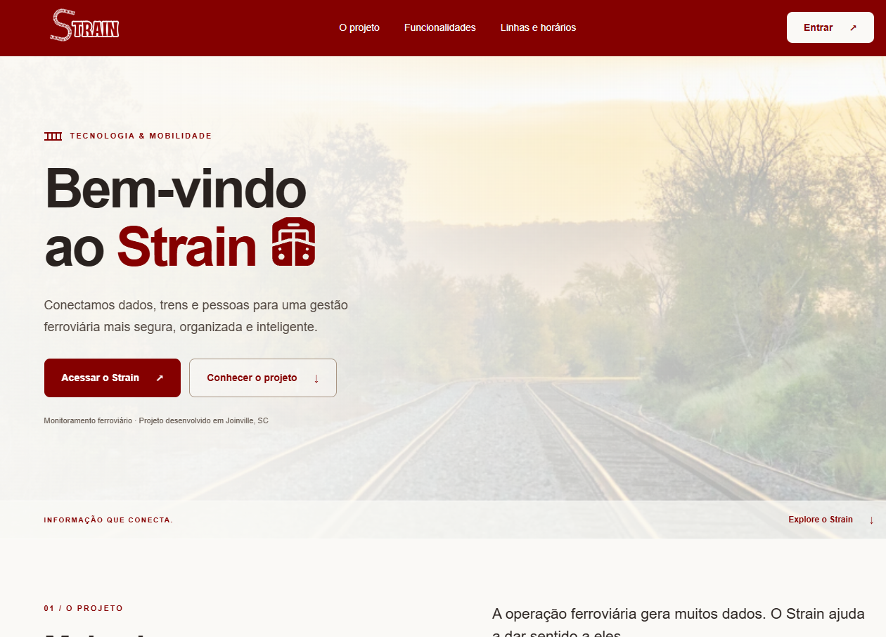
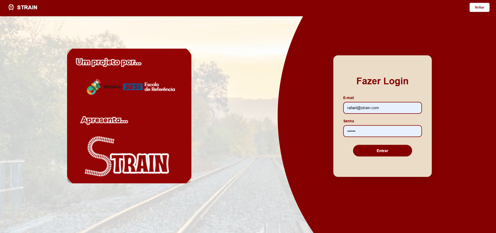
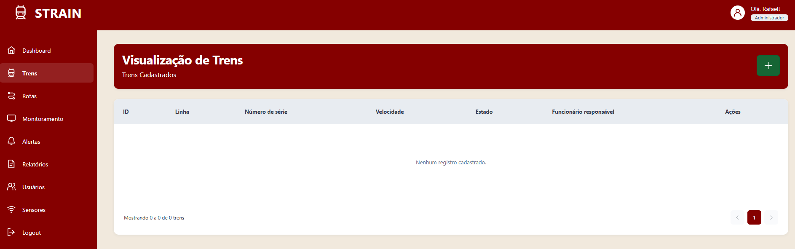
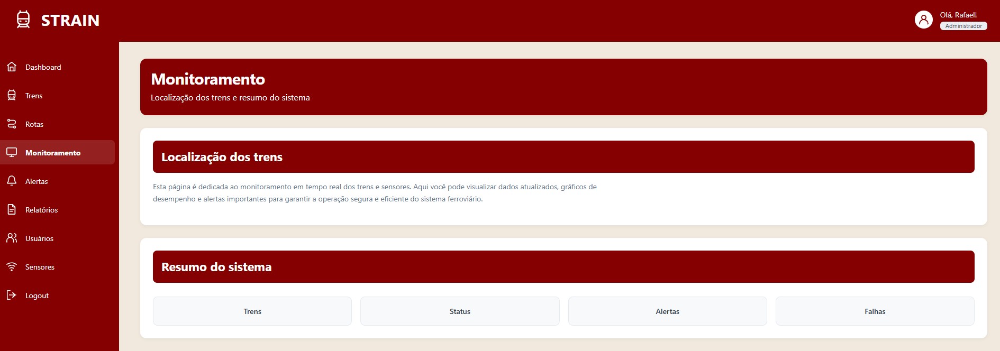

# SA_Ferrorama

## Proposta do Sistema:
Criar uma estrutura de códigos que receba, processe e exiba em tempo real os dados enviados pelos sensores IoT instalados na locomotiva e nos trilhos, permitindo o acompanhamento do desempenho do trem, a identificação de falhas e a geração de relatórios analíticos. A proposta busca facilitar a busca de informações e o acompanhamento das operações ferroviárias e dados necessários de forma mais organizada e em um único lugar.

---------------------------------------------------------------------------------------------

## Objetivos do projeto:
    O sistema procura facilitar e agilizar a busca de informações, além da gestão de: 

 * Localizações.
 * Trens.
 * Sensores.
 * Alarmes.
 * Trilhos.

---------------------------------------------------------------------------------------------

## Membros da equipe:
Luiz Felipe Sendreto dos Santos.
Juana Franciscão.
Nicole Jordan Amaral.
Rafael Tironi.

---------------------------------------------------------------------------------------------

# Funcionalidades 
As funcionalidades do site são:

## Regras de Negócio
 * O sistema deve receber dados em tempo real dos sensores instalados na locomotiva e nos trilhos.
 * O sistema deve validar os dados recebidos dos IoT.
 * O sistema deve exibir dados em tempo real em um painel (dashboard).
 * O sistema deve acabar a sessão, após logout, redirecionado para à tela de login.
 * O sistema deve gerar alertas em caso de problemas detectados.
 * O sistema deve armazenar os dados coletados.
 * O sistema deve permitir consulta de dados históricos.
 * O sistema deve gerar relatórios analíticos.
 * O sistema deve permitir o acompanhamento do desempenho do trem em tempo real.
 * O sistema deve permitir login de usuários (administrador, cliente etc ).
 * O sistema deve permitir exportação de relatórios (PDF, CSV, etc.).
 * O sistema deve disponibilizar a funcionalidade de log out,
 * O sistema deve exibir o nome do administrador autenticado na tela principal.
 * O sistema deve listar todos os sensores cadastrados com ID(trem, rotas, etc..), localização e tipo de dado monitorado.
 * O sistema deve disponibilizar o botão para visualização de detalhes de cada sensor.
 * O sistema deve disponibilizar um formulário com campos para nome do sensor,
 * localização e tipo de dado monitorado.
 * O sistema deve impedir a exclusão se o sensor possuir dados registrados.
 * O sistema exibir a mensagem: Não é possível excluir sensores com dados registrados.
 * O sistema deve exibir em tempo real a velocidade atual de cada trem monitorado.
 * O sistema deve exibir a localização do trem em mapa geográfico interativo.
 * O sistema deve exibir o status operacional de cada trem (Normal, Alerta ou Falha) com diferenciação visual.
 * O sistema deve localizar os usuários.

 ## Requisitos Funcionais
* O sistema deve receber dados em tempo real dos sensores instalados na locomotiva e nos trilhos.
* O sistema deve validar os dados recebidos dos IoT.
* O sistema deve exibir dados em tempo real em um painel (dashboard).
* O sistema deve acabar a sessão, após logout, redirecionado para à tela de login.
* O sistema deve gerar alertas em caso de problemas detectados.
* O sistema deve armazenar os dados coletados.
* O sistema deve permitir consulta de dados históricos.
* O sistema deve gerar relatórios analíticos.
* O sistema deve permitir o acompanhamento do desempenho do trem em tempo real.
* O sistema deve permitir login de usuários (administrador, cliente etc ).
* O sistema deve permitir exportação de relatórios (PDF, CSV, etc.).
* O sistema deve disponibilizar a funcionalidade de log out.
* O sistema deve exibir o nome do administrador autenticado na tela principal.
* O sistema deve listar todos os sensores cadastrados com ID(trem, rotas, etc..), localização e tipo de dado monitorado.
* O sistema deve disponibilizar o botão para visualização de detalhes de cada sensor.
* O sistema deve disponibilizar um formulário com campos para nome do sensor, localização e tipo de dado monitorado.
* O sistema deve impedir a exclusão se o sensor possuir dados registrados.
* O sistema exibir a mensagem: Não é possível excluir sensores com dados registrados.
* O sistema deve exibir em tempo real a velocidade atual de cada trem monitorado.
* O sistema deve exibir a localização do trem em mapa geográfico interativo.
* O sistema deve exibir o status operacional de cada trem (Normal, Alerta ou Falha) com diferenciação visual.
* O sistema deve localizar os usuários.

 ## Requisitos Não Funcionais
*  O sistema deve processar dados em tempo real com baixa latência.
* O sistema deve suportar grande volume de dados (alta escalabilidade).
* O sistema deve garantir segurança na comunicação (ex: criptografia).
* O sistema deve ter alta disponibilidade (mínimo de falhas).
* O sistema ter a interface deve ser intuitiva e de fácil uso.
* O sistema deve ter o tempo de resposta inferior a 2 segundos.
* O sistema deve ser compatível com diferentes dispositivos (desktop, tablet).
* O sistema deve possuir backup automático dos dados.
* O sistema deve garantir integridade e confiabilidade dos dados.
* O sistema deve seguir padrões de desenvolvimento e documentação.
* O sistema deve atualizar os dados do dashboard de monitoramento em tempo real em intervalos de no máximo 5 segundos.
* O sistema deve funcionar em no máximo 3 segundos em condições normais de rede.
* O sistema deve ter a geração de relatórios que não deve ultrapassar 10 segundos para períodos de até 30 dias de dados.
* O sistema deve suportar consultas simultâneas de múltiplos sensores sem degradação perceptível de performance.
* O sistema deve armazenar senhas utilizando algoritmo de hash seguro (bcrypt ou equivalente).
* O sistema deve realizar a comunicação entre cliente e servidor via protocolo HTTPS/TLS.
* O sistema deve implementar proteção contra ataques de SQL Injection e Cross-Site Scripting (XSS).
* O sistema deve encerrar automaticamente as sessões inativas por mais de 30 minutos.
* O sistema deve registrar log de auditoria para todas as operações críticas (login, logout, exclusões) com timestamp e ID do usuário.
* O sistema deve autenticar acesso às APIs de dados dos sensores via token (JWT ou equivalente).
* O sistema deve ter disponibilidade mínima de 99,5% ao mês (downtime máximo de 3,6 horas/mês).
* O sistema deve ser capaz de se recuperar automaticamente de falhas de conexão com os sensores IoT sem perda permanente de dados.
* O sistema deve, em caso de falha parcial, continuar operando os módulos não afetados (degradação elegante).
* O sistema deve ter uma rotina de backup automático diário com retenção mínima de 30 dias, no banco de dados.
* O sistema deve ter uma interface responsiva e adaptada para uso em monitores de desktop (resolução mínima 1280x720).
* O sistema deve ter as mensagens de erro claras, objetivas e orientadas ao usuário, sem expor detalhes técnicos internos.
* O sistema deve utilizar código de cores padronizado para indicar status (verde/amarelo/vermelho) no dashboard de monitoramento.
* O sistema deve permitir as confirmações de ações destrutivas (exclusão) que devem ser apresentadas em modal com opções claras de confirmar ou cancelar.
* O sistema deve permitir que a tela principal tenha um botão de logout visível.
* O sistema deve ter a integração com sensores IoT deve seguir protocolo padronizado (MQTT ou HTTP REST) para garantir interoperabilidade.
* O sistema deve ter um código-fonte que siga padrões de codificação documentados e boas práticas da linguagem/framework adotado.
* O sistema deve conter testes automatizados cobrindo ao menos os módulos de autenticação, cadastro e exclusão.
* O sistema deve ter a arquitetura que permita a adição de novos tipos de sensores sem necessidade de refatoração estrutural do sistema.
* O sistema deve suportar o crescimento do volume de dados históricos sem degradação das consultas de relatórios.
* O sistema deve ter a API de integração que deve ser documentada (padrão OpenAPI/Swagger) para facilitar a conexão de novos dispositivos.
* O sistema deve identificar falhas e anomalias automaticamente.
* O sistema deve validar os campos obrigatórios antes de salvar, impedindo cadastros incompletos.
* O sistema deve atualizar automaticamente os dados do dashboard semnecessidade de recarga manual da página.  

---------------------------------------------------------------------------------------------

## Metodologias:
    DevOps: Decidimos por essa metodologia porque ela permite que a equipe crie uma funcionalidade teste a mesma antes de adicionar mais coisas ao projeto, isso facilita o trabalho colaborativo, traz segurança e velocidade ao desenvolvimento.

    Kanban: O kanban é uma método de fluxo de trabalho que utiliza um quadro com colunas e cartões, optamos pela utilização dessa metodologia pois ela já está presente no git hub e permite de forma visual o acompanhamento das tarefas.

 ---------------------------------------------------------------------------------------------

## Tecnologias
  
* PHP — Desenvolvimento do sistema do backend;
* MySQL — Gerenciamento do banco de dados;
* HTML — Estrutura das páginas;
* CSS — Estilização e personalização do front-end;
* JavaScript — Interatividade e funcionalidades do sistema;
* XAMPP — Ambiente de desenvolvimento local;
* Git e GitHub — Versionamento e colaboração da equipe.

sa-ferrorama/
│
├── assets/
│   ├── img/
│   │   ├── 10.png
│   │   ├── 11.png
│   │   ├── 12.png
│   │   ├── 13.png
│   │   ├── alertas.png
│   │   ├── banner_logo2.png
│   │   ├── Captura de tela 2026-05-07 095347.png
│   │   ├── Captura de tela 2026-05-12 072739.png
│   │   ├── dashboard_2.png
│   │   ├── dashboard_certo.png
│   │   ├── dashboard.png
│   │   ├── desktop.ini
│   │   ├── dshb.png
│   │   ├── fundo_index.png
│   │   ├── fundo_index2.jpg
│   │   ├── fundo_index3.avif
│   │   ├── fundo_index4.jpg
│   │   ├── icone_da_navbar.png
│   │   ├── icons8-location-50.png
│   │   ├── icons8-location-update-50.png
│   │   ├── icons8-train-50.png
│   │   ├── image.png
│   │   ├── Linha azul.png
│   │   ├── Logo_index.png
│   │   ├── logo_navbar.png
│   │   ├── logo_navbar2.png
│   │   ├── logo_sesi_index.png
│   │   ├── logo.png
│   │   ├── Mapa.png
│   │   ├── Mockup- SA Juana, Luiz, Nicole, Rafael.png
│   │   ├── monitoramento.png
│   │   ├── Purple and Pink Modern Illustration Happy Halloween Circle Sticker (1).png
│   │   ├── Purple and Pink Modern Illustration Happy Halloween Circle Sticker (2).png
│   │   ├── Purple and Pink Modern Illustration Happy Halloween Circle Sticker (3).png
│   │   ├── relatorio_exemplo.png
│   │   ├── relatorios.png
│   │   ├── rotas_html.png
│   │   ├── Strain_navbar_index
│   │   ├── Strain.png
│   │   ├── Tela de login atualizada.png
│   │   ├── Tela de login.png
│   │   ├── teste
│   │   ├── trem_amarelo.png
│   │   ├── trem_azul.png
│   │   ├── trem_verde.png
│   │   ├── trem_vermelho.png
│   │   └── trens.png
│   │
│   └── style/
│       └── style.css
│       └── admin_paginas.css
│       └── cep.css
│       └── clima.css
│       └── home_usuario.css
│       └── landing.css
│       └── listagens.css
│
├── database/
│   └── db.sql
│
├── doc/
│   ├── apis.md
│   ├── identidade_visual.md
│   ├── manual.md
│   ├── pdo.md
│   ├── pesquisa-crude.md
│   ├── pesquisa-scrum.md
│   └── pesquisa-XAMPP.md
│   ├── relatorio-uso-ia.md
│
├── infra/
│   ├── conexao.php
│   └── verificar_acesso.php
│
├── public/
├── componentes/
│   │   ├── listagem_operacional.php
│   │   ├── listagem.php
│   │   ├── modais_listagem.php
│   │   ├── paginacao.php
│   │   ├── resposta_modal.php
│   │   └── visual.php
|   |
│   ├── funcionarios/
│   │   ├── cadastro_funcionarios.php
│   │   ├── editar_funcionarios.php
│   │   ├── excluir_funcionarios.php
│   │   └── login_funcionario.php
│   │
│   ├── rotas/
│   │   ├── cadastrar_rotas.php
│   │   ├── editar_rotas.php
│   │   ├── excluir_rotas.php
│   │   └── rotas.php
│   │
│   ├── sensores/
│   │   ├── cadastro_sensor.php
│   │   ├── editar_sensor.php
│   │   ├── excluir_sensor.php
│   │   └── visu_sensores.php
│   │
│   ├── Trens/
│   │   ├── editar_trens.php
│   │   ├── excluir_trens.php
│   │   ├── trens_cadastro.php
│   │   └── visualizar_trens.php
│   │
│   ├── usuarios/
│   │   ├── cadastro_usuarios.php
│   │   ├── editar_usuarios.php
│   │   ├── excluir_usuarios.php
│   │   ├── home_usuario.php
│   │   ├── login.php
│   │   ├── logout.php
│   │   └── visu_usuarios.php
│   │
│   ├── alertas.php
│   ├── dashboard.php
│   ├── monitoramento.php
│   └── relatorios.php
│
├── Scripts/
│   ├── botoes.js
│   ├── cep.js
│   ├── clima.js
│   ├── converter_senhas.php
│   ├── formulario_modal.js
│   ├── landing.js
│   ├── listagem.js
│   ├── script.js
│   └── validacao.js
│
├── index.php
└── README.md

## APIs utilizadas - Atividade 10

Durante a Atividade 10, integramos duas APIs ao Strain para adicionar novas funcionalidades ao sistema.

### 1. API ViaCEP

**Site:** https://viacep.com.br/

A API ViaCEP foi utilizada para consultar endereços a partir do CEP informado pelo usuário.

Com essa integração, conseguimos:

- Consultar o CEP durante o cadastro de usuários e funcionários.
- Preencher automaticamente os dados do endereço.
- Salvar o CEP no banco de dados.
- Mostrar os CEPs na tabela de usuários.
- Permitir a edição do número do CEP.

A edição do CEP foi simplificada para permitir alterar apenas o número, sem realizar uma nova consulta de endereço.

**Arquivos relacionados:**
- `Scripts/cep.js`
- `public/usuarios/cadastro_usuarios.php`
- `public/usuarios/editar_usuarios.php`
- `public/usuarios/visu_usuarios.php`
- `public/funcionarios/cadastro_funcionarios.php`

### 2. API Open-Meteo

**Site:** https://open-meteo.com/

A API Open-Meteo foi utilizada para mostrar informações sobre o clima de Joinville no dashboard do Strain.

Com ela, o sistema pode apresentar a temperatura atual e as condições meteorológicas da cidade.

**Arquivos relacionados:**
- `Scripts/clima.js`
- `assets/style/clima.css`
- `public/dashboard.php`

### Objetivo das integrações

O objetivo da atividade foi aprender a utilizar APIs externas e integrar as informações recebidas às funcionalidades do nosso sistema.

Durante o desenvolvimento, também realizamos ajustes nos códigos, na organização das páginas e no banco de dados para adaptar as APIs ao Strain.

## Pré-requisitos

Para executar o sistema Strain, é necessário ter os seguintes programas e recursos:

- **XAMPP:** ambiente de desenvolvimento que disponibiliza Apache, PHP e MySQL/MariaDB.
- **Navegador:** Google Chrome, Microsoft Edge ou Firefox.
- **Visual Studio Code:** recomendado para visualizar e editar os códigos.
- **Git:** opcional, para clonar o repositório do projeto.
- **Conexão com a internet:** necessária para utilizar as APIs ViaCEP e Open-Meteo.

---

## Instruções de instalação e configuração

Para instalar o Strain no computador, siga os passos:

1. Instale o XAMPP.
2. Baixe o projeto SA_Ferrorama pelo GitHub.
3. Extraia os arquivos, caso tenha baixado o projeto em ZIP.
4. Acesse a pasta `C:\xampp\htdocs`.
5. Coloque a pasta do projeto dentro de `htdocs`, utilizando o nome `sa-ferrorama`.
6. Abra o painel de controle do XAMPP.
7. Inicie os serviços Apache e MySQL.
8. Configure a conexão com o banco de dados no arquivo `infra/conexao.php`.

Após esses procedimentos, o sistema estará preparado para ser acessado pelo navegador, desde que o banco de dados esteja configurado corretamente.

---

## Configuração e importação do banco de dados

O Strain utiliza o MySQL para armazenar as informações dos usuários, funcionários, trens, sensores e rotas.

Para importar o banco de dados:

1. Abra o XAMPP e inicie o Apache e o MySQL.
2. Acesse `http://localhost/phpmyadmin`.
3. Crie um banco de dados com o nome definido no arquivo `infra/conexao.php`, caso ele ainda não exista.
4. Selecione o banco criado.
5. Clique na opção **Importar**.
6. Selecione o arquivo `database/db.sql`, localizado na pasta do projeto.
7. Clique em **Importar** ou **Executar**.
8. Verifique se as tabelas foram criadas corretamente.

Após a importação, confira as informações de conexão no arquivo `infra/conexao.php`, como nome do banco, usuário, senha e servidor.

---

## Como iniciar a aplicação

Após instalar e configurar o sistema:

1. Abra o XAMPP.
2. Inicie o Apache e o MySQL.
3. Abra um navegador.
4. Digite o endereço: `http://localhost/sa-ferrorama/`
5. A página inicial do Strain será exibida.
6. Clique no botão de login para acessar o sistema.
7. Entre com um usuário cadastrado no banco de dados.

Após a autenticação, o usuário será direcionado para a página correspondente ao seu perfil de acesso.

---

## Perfis de acesso e permissões

O Strain possui diferentes perfis de usuários, permitindo organizar o acesso às funcionalidades do sistema.

### Administrador

O administrador é responsável pelo gerenciamento geral do sistema.

**Permissões previstas:**

- Acessar o dashboard.
- Gerenciar usuários e funcionários.
- Cadastrar, visualizar, editar e excluir registros, conforme as regras do sistema.
- Gerenciar trens, sensores e rotas.
- Consultar relatórios e informações de monitoramento.
- Encerrar a sessão pelo botão de logout.

**Acesso de demonstração:**

- **Usuário:** `Rafael@strain`
- **Senha:** fornecida separadamente pela equipe.

Essa é uma conta fictícia, criada exclusivamente para demonstração do sistema.

### Funcionário

O funcionário é responsável pelo acompanhamento e gerenciamento das operações ferroviárias.

**Permissões previstas:**

- Acessar o dashboard operacional.
- Consultar informações dos trens.
- Visualizar sensores e rotas.
- Acompanhar informações de monitoramento.
- Consultar alertas e relatórios.
- Realizar operações de cadastro e edição, quando autorizado.

### Cliente

O cliente possui acesso às funcionalidades disponibilizadas aos usuários comuns.

**Permissões previstas:**

- Realizar cadastro e login.
- Acessar a página inicial do usuário.
- Consultar informações disponibilizadas pelo sistema.

---

## Contribuições dos integrantes

O projeto SA_Ferrorama foi desenvolvido em equipe, com a participação dos seguintes integrantes:

- **Luiz Felipe Sendreto dos Santos:** Front-end, Kanban, revisão, testes, back-end e organização.
- **Juana Franciscão:** Front-end, documentação, revisão, testes, back-end e Kanban.
- **Nicole Jordan Amaral:** Front-end, documentação, testes, back-end e Kanban.
- **Rafael Tironi:** Front-end, Kanban, revisão, testes, back-end e organização.

A equipe utilizou Git e GitHub para organizar o desenvolvimento, compartilhar alterações e acompanhar as tarefas do projeto.

---

## Capturas de tela da versão final

As imagens a seguir apresentam as principais interfaces do Strain.

### Página inicial

### Tela de login

### Dashboard

### Gerenciamento de trens

### Monitoramento

---

## Limitações conhecidas

O Strain foi desenvolvido como um projeto acadêmico, utilizando um ambiente de desenvolvimento local.

Entre as possíveis limitações que devem ser verificadas, estão:

- **Ambiente local:** o sistema foi configurado para execução pelo XAMPP, não havendo confirmação de implantação em um servidor público.
- **Sensores IoT:** é necessário confirmar se a comunicação com sensores físicos em tempo real está implementada ou se os dados utilizados são apenas demonstrativos.
- **Monitoramento:** algumas funcionalidades de acompanhamento ferroviário podem depender de integrações adicionais com sensores e dispositivos.
- **Relatórios:** é necessário verificar quais recursos de geração e exportação de relatórios estão realmente implementados.
- **APIs externas:** a consulta de CEP e das condições meteorológicas depende da disponibilidade dos serviços ViaCEP e Open-Meteo.
